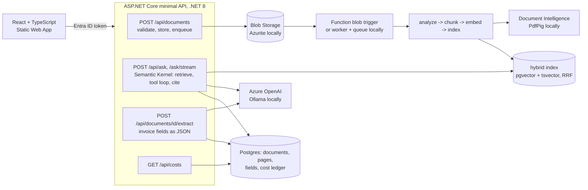

# azure-doc-assistant: business documents, questions with citations, extracted fields

Upload invoices, contracts and manuals, ask questions and get answers that cite the page they came
from, and pull structured fields out of invoices. Built the way an Azure shop builds it: C# / .NET 8
minimal API, Semantic Kernel for retrieval-augmented answering and function calling, a React + TypeScript
front end, a blob-triggered Azure Function for ingestion, Entra ID sign-in, Key Vault, Application
Insights, Bicep. And built so that all of it also runs on a laptop with no Azure account: every Azure
service sits behind an interface with a free local implementation (Ollama, PdfPig, pgvector, Azurite),
which is what the tests, the evaluation and the numbers below use.

MIT licence. Synthetic data only.

## What it does



A question is one trace: the HTTP span, `ask`, `ask.retrieve`, one `ask.model.round` per model call,
`ask.tool` per function call (`search_documents`, `lookup_invoice`, `list_documents`). Every answer
carries its citations, the sources it saw, the tools it used, token counts and the cost at list prices.

## Measured

All numbers come from committed tools run on 2026-10-17 on one machine (Windows 11, i7, RTX 4060 8 GB,
Docker Desktop). The model is **a local 3-billion-parameter model (`qwen2.5:3b` through Ollama), not
Azure OpenAI**; Azure numbers will be added after a deployment with his credit. The corpus is synthetic,
born-digital and small, so these are an upper bound for messy real documents.

### Evaluation (`make evals`, `tools/DocAssistant.Evals`, 28 documents, 46 questions)

| Metric | Value |
|---|---|
| Answer accuracy (44 answerable questions; numbers within 0.5%, dates in any rendering, names by normalised substring) | 86.4% |
| Citation rate (at least one citation points at the document the fact came from) | 77.3% |
| Unanswerable questions declined (n=2) | 2/2 |
| Invoice field extraction, model path, 8 fields x 20 invoices | 100% (160/160) |
| Latency p50 / p95 per question (local GPU) | 1.2 s / 4.9 s |
| Function calls across the set (`lookup_invoice`, `search_documents`) | 22 |
| Ingestion (PdfPig + nomic-embed-text + pgvector), 31 pages | 2.8 s, 655 pages/min |
| Cost | $0 (local); the API prices Azure models from recorded token counts |

Source: `evals/results/latest-ollama-qwen2_5-3b.md`. CI runs the same tool with the deterministic
stand-in model (`evals/results/latest-fake.md`, gate in `evals/baseline.json`): it cannot answer, so
its gate checks plumbing only: all 28 documents indexed, top-1 retrieval of the expected document for
72.7% of questions with the hash embedder, 100% regex extraction, p95 13 ms per request.

By category the misses cluster in one place:
questions about the five master-services agreements, which share one layout, scored 2/5 on the monthly
fee because retrieval returned the wrong agreement or the model answered with a bare citation marker.
Invoice totals, tax, dates and customers scored 100%, manual specifications 83%, contract notice periods
100%. A second run of the same set scored 88.6%; expect about two points of run-to-run variance from
the local model.

### Tests and checks

| Check | Result |
|---|---|
| Unit tests (`make test-unit`) | 52 passed: chunking, citations, scoring, regex and LLM extraction, pricing, usage reading, the fake model, dev tokens, PdfPig, the orchestrator with the fake model, the tool loop with a scripted model (executed, bounded, failing tool), the worker loop |
| Integration tests (`make test-integration`, Testcontainers pgvector + Azurite) | 7 passed: health, auth, upload validation, upload-ingest-ask-extract-delete end to end, per-user isolation, SSE stream, rate limit, poison-message handling |
| Combined line coverage (Core, Infrastructure, Api, Worker) | 67.2% (CI floor 65%) |
| Web (`web/`) | ESLint, Prettier, `tsc` strict, 3 Vitest tests, Vite build |
| End to end (`make e2e`, Playwright against the compose stack) | 2 passed: sign in, upload, wait for Ready, ask with a citation, extract fields, delete; unauthenticated calls rejected |
| Alert rules | 6 rules, 7 promtool unit tests, all firing and silent as specified |
| Infrastructure | `az bicep build` and `az bicep lint` clean |
| Images | API 371 MB, worker 327 MB, non-root, health checks |

## Quick start

```bash
ollama pull qwen2.5:3b && ollama pull nomic-embed-text    # the local models (free)
cp .env.example .env
make up                 # API :8080, worker, Postgres (pgvector) :5434, Azurite
make corpus             # 20 invoices, 5 contracts, 3 manuals + evals/questions.json
cd web && cp .env.example .env.local && npm ci && npm run dev    # http://localhost:5173
```

Sign in with any test user name (development auth), upload PDFs from `data/synthetic`, ask
"What is the total amount due on invoice INV-1001?". `make up-obs` adds Grafana (dashboard
"Document assistant"), Prometheus, Alertmanager, Tempo. `make evals LABEL=ollama-qwen2.5-3b` reproduces
the table above. `AI_PROVIDER=fake make up` runs with a deterministic stand-in model for plumbing tests.
See [docs/DEPLOY.md](docs/DEPLOY.md) for Azure.

## API

| Method and path | Purpose |
|---|---|
| `POST /api/documents` (multipart `file`) | Upload a PDF (type, size and `%PDF` header checked); 202 with the record; indexed asynchronously |
| `GET /api/documents`, `GET /api/documents/{id}`, `DELETE /api/documents/{id}` | The caller's documents only |
| `GET /api/documents/{id}/pages` | Extracted page text |
| `POST /api/documents/{id}/extract`, `GET /api/documents/{id}/fields` | Invoice fields (model when configured, regex baseline otherwise); method recorded |
| `POST /api/ask` `{question, documentId?}` | Answer, citations, sources, tool calls, usage, latency, model |
| `POST /api/ask/stream` | Same as server-sent events: `sources`, `token`, `tool`, `done` |
| `GET /api/costs?days=30` | The caller's token spend by operation and day |
| `POST /auth/dev-token` (dev mode only), `GET /auth/me` | Development sign-in |
| `GET /healthz`, `GET /readyz`, `GET /metrics`, `/swagger` | Probes, Prometheus, OpenAPI |

Authentication is a bearer token: Entra ID (`Auth:Mode=entra`, Microsoft.Identity.Web) in Azure, a
development issuer locally. The owner id is the token's `oid`; every query is scoped by it. Chat and
upload endpoints are rate limited per user.

## How the answer is produced

1. The question is embedded and searched with hybrid retrieval: pgvector cosine similarity and a
   `tsvector` keyword rank fused by reciprocal rank fusion, in one SQL statement, filtered by owner.
2. The top 8 passages become numbered sources in the system prompt.
3. Semantic Kernel runs the model with function choice enabled but **not** auto-invoked: each round
   streams text and collects tool calls; tools run through the kernel with the caller's owner id; results
   and any new passages are appended; at most four rounds (`docs/decisions/0002`).
4. `[n]` markers in the answer are resolved to document, page and chunk. Usage is read from every round
   and priced; if a provider reports no usage, tokens are estimated and flagged.

Extraction sends the page text with a JSON-only instruction and `response_format: json_object`;
unparsable output falls back to the regex extractor and is labelled `regex-fallback`.

## Observability

- JSON logs on stdout (`turn` and `ingested` lines carry ids, timings, tokens, cost).
- Metrics (OpenTelemetry, Prometheus exposition): answers by status and whether cited, latency
  histogram, tokens, cost, tool calls, ingestion pages and outcomes, ASP.NET Core and runtime metrics.
- Traces to Tempo locally (OTLP/HTTP) and Application Insights in Azure (Azure Monitor distro).
- Alerts (`observability/alert_rules.yml`): API down, ask error rate, p95 latency, ingestion failures,
  model spend, uncited-answer share; each with a promtool unit test.
- Grafana dashboard provisioned from `observability/grafana/dashboards/docassistant.json`.

## Security

Entra ID or signed dev tokens; owner scoping in every query; private blob container with files under
`{owner}/{id}.pdf`; upload validation; question length limits; per-user rate limits; CORS allow-list;
secrets only in environment variables or Key Vault (managed identities for Azure OpenAI, Document
Intelligence and storage; `disableLocalAuth` on the AI accounts); pinned packages; Dependabot for
NuGet, npm, Actions and Docker; gitleaks in CI; non-root containers.

## Repository layout

```
src/DocAssistant.Core             domain, ports, chunking, pipeline, RAG orchestration (Semantic Kernel), extraction, scoring, pricing
src/DocAssistant.Infrastructure   pgvector index, Postgres repositories, Blob/Queue storage, PdfPig and Document Intelligence analyzers,
                                  kernel factory (Azure OpenAI / Ollama / fake), DI registration
src/DocAssistant.Api              minimal API, auth, rate limiting, OpenTelemetry, Swagger
src/DocAssistant.Worker           queue-polling ingestion host with /healthz and /metrics
src/DocAssistant.Functions        Azure Functions isolated worker, blob-triggered ingestion (compiles; runs only in Azure)
tools/DocAssistant.SynthData      synthetic corpus and eval questions (QuestPDF)
tools/DocAssistant.Evals          end-to-end evaluation against a running API
tests/                            unit and integration (Testcontainers) tests
web/                              React + TypeScript (Vite), Playwright e2e
observability/                    Prometheus, alert rules and tests, Alertmanager, OTel collector, Tempo, Grafana
infra/bicep/                      main.bicep, resources.bicep, deploy.sh, teardown.sh
docs/                             PLAN, DEPLOY, decisions/0001-0005
```

## Limitations, stated plainly

- Every quality number above comes from a 3B local model on a clean synthetic corpus. Azure OpenAI
  numbers do not exist yet; the Document Intelligence analyzer and the Functions host are compiled and
  deployable but not exercised by this repository's tests.
- Near-duplicate documents (five contracts with one layout) are where retrieval and the small model
  fail; a reranker or document-level filters would be the next step.
- Azure AI Search is not implemented; pgvector on Azure Database for PostgreSQL fills the same port.
- Documents have one owner; there is no sharing model, no retention policy, no OCR for scanned PDFs.
- The eval set is 46 questions generated from the corpus's own facts: a smoke-level set, not a benchmark.
