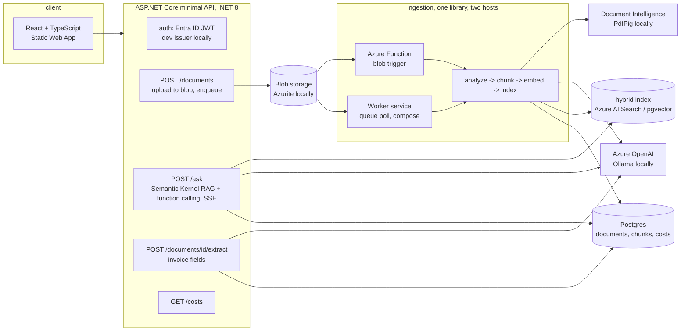

# Plan: document assistant on .NET 8, Semantic Kernel and Azure

Goal: upload business documents (invoices, contracts, manuals), ask questions and get answers with
citations, and extract structured fields, built the way an Azure shop would build it (Publix's posting:
.NET and C#, React, Azure Functions, App Service, Static Web Apps, Azure OpenAI, Document Intelligence,
RAG and function calling, Semantic Kernel) while running completely, and for free, on a laptop.

## Architecture

Every Azure dependency sits behind an interface with a local implementation, so the whole system, its
tests and its evaluation run with no Azure account:

| Concern | Azure (production) | Local (compose, CI) |
|---|---|---|
| Chat and embeddings | Azure OpenAI through Semantic Kernel | Ollama (`qwen2.5:3b`, `nomic-embed-text`) through Semantic Kernel's OpenAI connector; a deterministic fake in unit tests |
| Document analysis | Document Intelligence layout + prebuilt-invoice | PdfPig text and positions, invoice fields by the same extraction prompt |
| Hybrid search | Azure AI Search (vector + BM25, RRF) | Postgres + pgvector (cosine) + `tsvector` (BM25-like), reciprocal rank fusion in SQL |
| Files and triggers | Blob Storage + Functions blob trigger | Azurite (same SDK, same code) + a worker that polls a storage queue |
| Secrets | Key Vault via managed identity | environment variables |
| Identity | Entra ID (Microsoft.Identity.Web) | a development token issuer with the same claims |
| Telemetry | Application Insights via the Azure Monitor OpenTelemetry distro | OpenTelemetry to Tempo and Prometheus, Grafana dashboard |
| Hosting | App Service (API), Functions, Static Web Apps, Bicep | Docker Compose |

## Milestones

| # | Milestone | Done when | Status (2026-10-17) |
|---|---|---|---|
| 1 | Core: domain, chunking, interfaces, RAG orchestration with Semantic Kernel (search plugin, invoice plugin, citations), extraction, cost accounting | unit tests pass with the fake model | done, 47 unit tests |
| 2 | Infrastructure: pgvector index, PdfPig analyzer, Ollama/Azure OpenAI services, Blob/Queue storage, Postgres repositories | integration tests pass against Testcontainers (pgvector + Azurite) | done, 7 integration tests |
| 3 | API and worker: upload, ingest, ask (SSE), extract, costs, health, auth, rate limiting, per-user isolation, OTel | API tests through `WebApplicationFactory`; an upload becomes an answer end to end | done |
| 4 | Synthetic corpus: invoices, contracts, manuals rendered with QuestPDF with known ground truth; 30+ eval questions | `tools/DocAssistant.Evals` reports answer accuracy, citation rate, pages per minute with Ollama | done, 46 questions, numbers in README |
| 5 | Web: React + TypeScript, upload, chat with citations, extraction, costs; Playwright end to end | e2e passes against compose | done |
| 6 | Observability: JSON logs, metrics, traces, dashboard, alerts with promtool tests | alert tests pass | done, 6 rules, 7 promtool tests |
| 7 | Azure: Bicep for every resource, OIDC deploy workflow, teardown | `az bicep build` passes in CI; apply is a manual step | templates build and lint clean; not applied (needs his account) |
| 8 | Docs: README with measured numbers, ADRs | | done, 5 ADRs |
| 9 | Azure OpenAI eval run (gpt-4o-mini) after deployment, Azure AI Search index implementation | numbers per model in README | open, after he deploys |

## Definition of done

The section-3 standard of the mission: deployable from IaC with one command and removable with one;
CI with lint, format, types, tests, security scan; unit, integration (Testcontainers) and end-to-end
tests with coverage; JSON logs, metrics, traces, a dashboard and an alert that fires in a test; auth,
secrets outside the repo, validation, rate limiting, pinned dependencies, Dependabot; `.env.example`,
compose, health and readiness, graceful shutdown; README with diagram, quick start, tests, deploy,
results with methodology and limitations; 3 to 5 ADRs; one measured number; synthetic data only; MIT.

## Numbers to produce

- Answer accuracy and citation rate on the eval set, stated per model (local Ollama model first;
  Azure OpenAI after a deployment with his credit).
- Ingestion throughput in pages per minute (local analyzer and embedder, single machine).
- Cost per answer from recorded token usage at list prices.

## Cost

Azure for Students credit covers: Azure OpenAI gpt-4o-mini and text-embedding-3-small (cents for the
eval set), AI Search Free tier (50 MB, 3 indexes, vector search included), Document Intelligence F0
(500 pages/month free), Functions Consumption (free grant), Static Web Apps Free, App Service F1 (free,
60 CPU-minutes/day) or B1 (about $13/month), Key Vault and Blob (cents), Application Insights (5 GB/month
free). Nothing is created until he runs the deploy himself.
